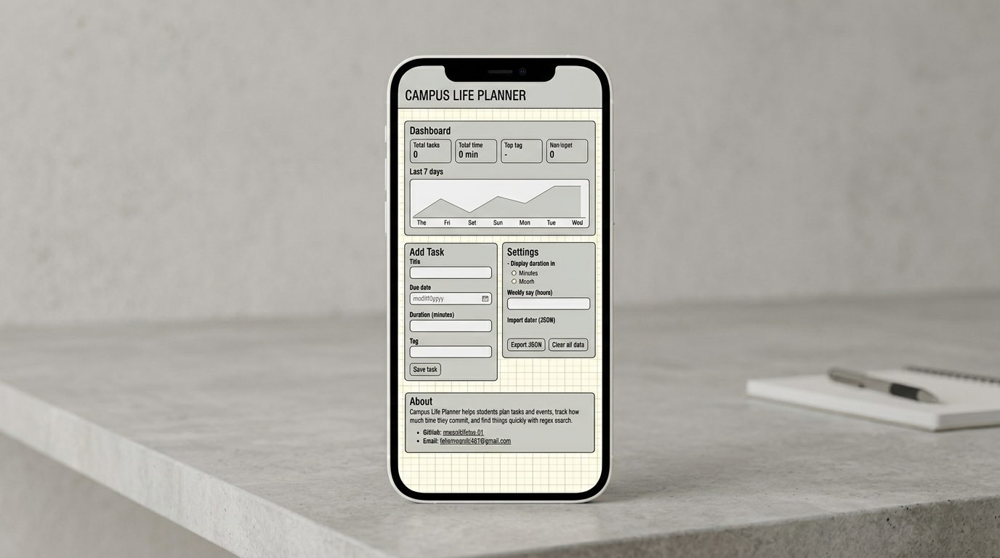

# Campus Life Planner

An accessible, responsive planner for students to track tasks and events, see how much time they are committing each week, and find anything quickly with regex search. Built with **vanilla HTML, CSS and JavaScript** (no frameworks).

- **Theme:** Campus Life Planner
- **Live site (GitHub Pages):** https://github.com/mwanikifelix-01/summative_building_responsive_UI.git
- **Demo video:**mhttps://youtu.be/FBe1HaO4GNM
- **Author:** Felix Mwaniki · [GitHub](https://github.com/mwanikifelix-01)

---

## Features

- **Add, edit and delete tasks** with title, due date, duration and tag
  - Inline editing in the table (Enter saves, Esc cancels)
  - Delete asks for confirmation
  - `createdAt` / `updatedAt` timestamps kept automatically
- **Regex validation** on every field with clear inline error messages (4 rules + 1 advanced back-reference rule)
- **Sortable table** by title (A↕Z), due date and duration (↑↓); shown as cards on mobile
- **Live regex search** with a safe compiler (invalid patterns never crash), case-insensitive toggle, `@tag:` filter and `<mark>` highlighting
- **Dashboard:** total tasks, total time, top tag and a 7-day bar chart
- **Weekly cap:** set a limit in hours; the message is polite while under the cap and assertive when it is exceeded
- **Units:** durations stored in minutes, displayed in minutes or hours (setting)
- **Persistence:** all tasks and settings auto-save to `localStorage`
- **Import / Export JSON** with full validation before anything is loaded
- **Accessible:** semantic landmarks, skip link, labelled inputs, visible focus, ARIA live regions, keyboard-only use
- **Responsive:** mobile-first with breakpoints at ~360px, 768px and 1024px
- **Animation:** cards fade in, chart bars grow, skip link slides in (all disabled under `prefers-reduced-motion`)

---

## How to Run

The app uses ES modules, so it must be served over HTTP (opening `index.html` directly with `file://` will not work).

**Option A – VS Code:** right-click `index.html` → **Open with Live Server**.

**Option B – Terminal:**
```bash
python3 -m http.server
```
then open http://localhost:8000

### Load the sample data
Go to **Settings → Import tasks (JSON)** and choose `seed.json`. It contains 12 tasks covering edge cases (leap day, year end, 0 and 600 minutes, decimals, time tokens like `14:30`, tags with hyphens and spaces, and titles with quotes, `<`, `>` and `&`).

---

## Running the Tests

1. Start the app with Live Server or `python3 -m http.server` (as above).
2. Open `tests.html` (e.g. http://localhost:8000/tests.html).
3. The page runs 34 assertions against `scripts/validators.js` and shows a summary at the top.

All tests should pass: **34 passed, 0 failed**.

---

## Keyboard Map

| Key | Action |
|---|---|
| `Tab` / `Shift + Tab` | Move forward / backward between links, inputs and buttons |
| `Enter` | Activate a link or button; submit the Add Task form |
| `Space` | Toggle checkbox / select radio button |
| First `Tab` on page load | Reveals the **Skip to content** link |
| `Enter` on a column header | Sort by that column (press again to reverse) |
| `Enter` in an edit-row input | Save the edit |
| `Esc` in an edit row | Cancel the edit |
| `Esc` in the delete / import confirmation | Cancel |

After saving an edit, focus returns to that task's **Edit** button. After deleting, focus moves to the search box. On a failed submit, focus jumps to the first invalid field.

---

## Data Model

Each task is stored as a JSON object. All tasks are kept in an array and auto-saved to `localStorage`.

```json
{
  "id": "task_0001",
  "title": "Read chapter 4 for Data Structures",
  "dueDate": "2026-10-14",
  "duration": 90,
  "tag": "Study",
  "createdAt": "2026-10-10T08:15:00.000Z",
  "updatedAt": "2026-10-10T08:15:00.000Z"
}
```

| Field | Type | Description | Validation |
|---|---|---|---|
| `id` | string | Unique identifier, `task_` + zero-padded number | Generated automatically, never edited |
| `title` | string | What the task or event is | No leading/trailing spaces, no double spaces, no duplicate words (e.g. "the the") |
| `dueDate` | string | Date the task is due, format `YYYY-MM-DD` | Regex check plus a real-date check (rejects `2026-02-31`) |
| `duration` | number | Time needed, always stored in **minutes** | Non-negative number, up to 2 decimals |
| `tag` | string | Category, e.g. Study, Class, Assignment, Exam, Club, Personal | Letters only, single spaces or hyphens between words |
| `createdAt` | string | ISO 8601 timestamp set when the task is created | Set automatically |
| `updatedAt` | string | ISO 8601 timestamp, refreshed on every edit | Set automatically |

### Notes
- **Units:** `duration` is stored in minutes only. Hours are a display conversion chosen in Settings, so sorting and stats always use one unit.
- **Persistence:** every add, edit, delete or import saves the full array to `localStorage` (`campus-planner:tasks`). Settings are saved separately (`campus-planner:settings`).
- **Import/Export:** exported files contain this same array. On import, every record is checked for all seven fields, correct types, the same regex rules as the form, valid timestamps and unique ids. If any record fails, the whole file is rejected with a message naming the task and the problem, and nothing is loaded.
- **Past dates are allowed** on purpose: the 7-day chart needs them, and older tasks must remain editable.

---

## Regex Catalog

| Rule | Pattern | Matches | Rejects |
|---|---|---|---|
| Title: no leading/trailing spaces | `^\S(?:.*\S)?$` | `Read chapter 4` | ` Read chapter 4 ` |
| Title: double spaces | `\s{2,}` | flags `Read  chapter` | — |
| Duration | `^(0\|[1-9]\d*)(\.\d{1,2})?$` | `0`, `90`, `45.5` | `007`, `-5`, `1.234` |
| Due date | `^\d{4}-(0[1-9]\|1[0-2])-(0[1-9]\|[12]\d\|3[01])$` | `2026-10-14` | `2026-13-01`, `14/10/2026` |
| Tag | `^[A-Za-z]+(?:[ -][A-Za-z]+)*$` | `Study`, `Group-Work`, `Club Meeting` | `Study1`, `Group--Work` |
| **Advanced:** duplicate words (back-reference) | `\b(\w+)\s+\1\b` (flag `i`) | `Read the the notes` | `Read the notes`, `the there` |
| Search: filter by tag | `^@tag:([A-Za-z-]+)$` (flag `i`) | `@tag:Exam`, `@tag:Group-Work` | `@tag:` |
| Search: time tokens | `\b([01]\d\|2[0-3]):[0-5]\d\b` | `14:30`, `09:05` | `25:00`, `9:5` |

- The date regex is followed by a JavaScript check that the date actually exists, so `2026-02-31` is rejected and `2028-02-29` (leap year) is accepted.
- Search patterns are compiled with `try/catch`; an invalid pattern such as `(exam` shows an error message instead of breaking the page.
- The duplicate-word error names the repeated word, e.g. *Repeated word: "the".*

---

## Accessibility Notes

- **Landmarks:** `header`, `nav`, `main`, `section` (each with an `h2`) and `footer`. One `h1` per page.
- **Skip link:** "Skip to content" is the first focusable element and jumps to `#main`.
- **Forms:** every input has a `<label for>` (edit-row inputs use visually hidden labels). Errors are linked with `aria-describedby`, inputs get `aria-invalid="true"`, and focus moves to the first invalid field.
- **Live regions:** a `role="status"` region announces adds, edits, deletes, sorting, search result counts and imports. The weekly cap message uses `aria-live="polite"` under the cap and `aria-live="assertive"` once exceeded.
- **Table:** sort controls are `<button>`s inside `<th>`, with `aria-sort` on the active column. Edit and Delete buttons have `aria-label`s that include the task title.
- **Chart:** has `role="img"` and an `aria-label` listing the minutes for each day, so screen-reader users get the data.
- **Search highlights:** matches are wrapped in `<mark>` without changing text order. All user text is HTML-escaped, so titles like `<b>notes</b>` display as text.
- **Focus:** visible `:focus-visible` outline on every interactive element.
- **Colour contrast (WCAG AA):**

  | Text / element | Background | Ratio |
  |---|---|---|
  | Body text `#1b1f2a` | White | 16.5 : 1 |
  | Muted text `#4a5468` | White | 7.6 : 1 |
  | Links / primary `#1d4ed8` | White | 6.7 : 1 |
  | White text on primary button | `#1d4ed8` | 6.7 : 1 |
  | Error text `#b91c1c` | White | 6.5 : 1 |
  | Focus outline `#b45309` | White | 5.0 : 1 (min. 3 : 1) |

- **Colour is never the only signal:** errors have text and a ⚠ icon; the over-cap message changes wording as well as colour; sort direction is shown with ▲/▼ and `aria-sort`.
- **Motion:** all animations and transitions are disabled under `prefers-reduced-motion: reduce`.

---

## Responsive Design

Mobile-first CSS with Flexbox and three breakpoints:

| Width | Layout |
|---|---|
| < 360px | Single column, stats stacked |
| ≥ 360px | Stats in two columns |
| ≥ 768px | Header in one row, tasks shown as a real table instead of cards |
| ≥ 1024px | Two-column layout: dashboard + form beside the task table |

---

## Wireframes




---

## File Structure

```
index.html          Main app page
tests.html          Validator tests (34 assertions)
seed.json           12 sample tasks for import
README.md
styles/
  main.css          Mobile-first styles, breakpoints, animations
scripts/
  main.js           Wires the page to the modules (events, rendering, settings)
  validators.js     Regex rules and validation functions
  state.js          Task list, add/edit/delete, sorting, dashboard stats
  search.js         Safe regex compiler, filtering, highlighting, HTML escaping
  ui.js             Draws the table, edit row, dashboard and cap message
  storage.js        localStorage, JSON import/export with validation
assets/
  wireframes/       Sketches (mobile, tablet, desktop)
```

---

## Milestones

| Milestone | Work |
|---|---|
| M1 | Spec, data model, regex catalog, accessibility plan, wireframes |
| M2 | Semantic HTML structure and mobile-first CSS |
| M3 | Regex validators, form errors, `tests.html` |
| M4 | Table/cards rendering, sorting, live regex search, inline edit, delete |
| M5 | Dashboard stats, 7-day chart, weekly cap with live messages |
| M6 | localStorage persistence, JSON import/export, unit and cap settings |
| M7 | Seed data, README, accessibility audit, deployment, demo video |
